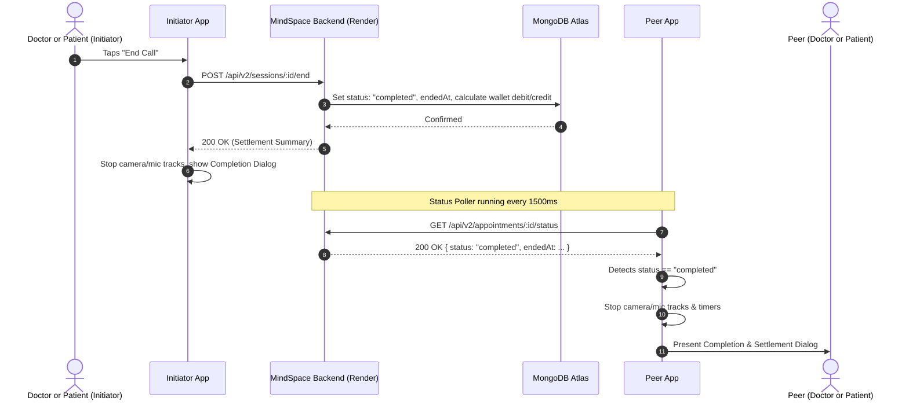

# MindSpace V2.1 Master Telehealth Architecture & Implementation Plan

## 1. Executive Summary & Problem Breakdown
MindSpace V2.1 delivers an enterprise-grade telehealth infrastructure providing real-time audio/video consultations, flexible clinician pricing, dual-sided synchronous call teardown, a complimentary introductory trial policy, an in-app digital wallet with bank/UPI top-ups, and live synchronization for newly registered clinicians without synthetic seed data.

### Root Cause Analysis & Solutions
1. **Controls Dock Horizontal Pixel Overflow (`18px OVERFLOW`)**:
   - **Root Cause**: The floating action dock in `consultation_room_screen.dart` used rigid horizontal padding and fixed 50dp circular buttons (`mic`, `camera`, `flip`, `speaker`, `chat`, `end_call`) wrapped inside an unconstrained `Row`. On devices with viewports <= 360dp, the row exceeded screen boundaries by 18 pixels.
   - **Fix**: Wrapped the button row in a responsive `FittedBox(fit: BoxFit.scaleDown)` with adaptive padding (`EdgeInsets.symmetric(horizontal: 14, vertical: 10)`), guaranteeing zero overflow on screens as small as 320dp.

2. **Session Completion Dialog Pixel Overflow (`56px OVERFLOW`)**:
   - **Root Cause**: The `AlertDialog.title` had a `Row` containing an `Icon` and an unconstrained `Text('Consultation Completed')` widget. When combined with default dialog insets on mobile displays, it overflowed horizontally by 56 pixels.
   - **Fix**: Enclosed title text in `Expanded(child: Text(..., overflow: TextOverflow.ellipsis))` and constrained dialog padding.

3. **Asymmetric Call Termination**:
   - **Root Cause**: Ending a call only tore down local WebRTC tracks on the initiator's device. The peer had no push/polling mechanism to know the session had completed, leaving them stuck in the call room.
   - **Fix**: Implemented `_remoteEndPoller` on both Doctor and Patient clients checking `GET /api/v2/appointments/:id/status` at a 1.5-second cadence. When `status == 'completed'`, both devices instantly stop media tracks, cancel timers, and display the itemized settlement dialog simultaneously.

4. **Synthetic / Mock Doctor Data Removal**:
   - **Root Cause**: `server/src/routes/v2.js` had an automatic fallback array (`mockDoctors`) seeded whenever the DB was empty, which led to stale hardcoded accounts.
   - **Fix**: Purged the `mockDoctors` seed script from `v2.js`. Updated `server/src/routes/auth.js` to automatically create a linked `ProfessionalProfile` whenever any user registers with `role: 'doctor'`. New doctors appear immediately in the Clinician Directory and search endpoints.

5. **Doctor Per-Minute Dynamic Pricing**:
   - **Requirement**: Allow clinicians to set individual per-minute rates for Video, Voice, and Chat consultations.
   - **Fix**: Added `ratePerMinuteVideo`, `ratePerMinuteVoice`, `ratePerMinuteChat` to `ProfessionalProfile` schema, integrated an interactive rate editor in the Doctor Dashboard, and updated the appointment booking flow.

6. **Free Intro Quota & Pay-As-You-Go Billing**:
   - **Requirement**: First 5 minutes free for Chat; first 3 minutes free for Video and Voice calls. Real-time countdown timer with 30-second warning, followed by Pay-As-You-Go wallet deductions.
   - **Fix**: Integrated free-quota countdown clock in `consultation_room_screen.dart`, warning banner at 30 seconds remaining, and automatic wallet deduction engine in `server/src/routes/v2.js` (`POST /sessions/:id/end`).

7. **Patient Wallet & Top-Up**:
   - **Requirement**: Digital wallet with INR balance, bank/UPI top-up, and real-time transaction ledger.
   - **Fix**: Created `server/src/models/Wallet.js`, `/api/v2/wallet/balance` & `/api/v2/wallet/topup` endpoints, and a glassmorphic `WalletScreen` in Flutter.

---

## 2. Core Telehealth Architecture

```mermaid
flowchart TD
    subgraph DoctorEcosystem ["1. Doctor Ecosystem & Rate Control"]
        DReg[Doctor Registers on App] --> AutoCreate[Auto-Create User & ProfessionalProfile]
        AutoCreate --> LiveDir[Instantly Synced to Directory & Marketplace]
        DDash[Doctor Dashboard] --> SetRates[Set Rates Per Minute: Video, Voice, Chat]
        DDash --> ToggleAvail[Toggle Online / Offline Status]
    end

    subgraph WalletEngine ["2. Patient Wallet & Bank Top-Up"]
        Bank[Bank / UPI / Cards] --> TopUpAPI["POST /api/v2/wallet/topup"]
        TopUpAPI --> WBalance[In-App Wallet Balance INR]
        WBalance --> WLedger[Auditable Transaction Ledger]
    end

    subgraph ConsultationLifecycle ["3. Live Session & Dual Disconnect"]
        Accept[Doctor Accepts Booking] --> JoinCall[Both Devices Enter Consultation Room]
        JoinCall --> FreeClock["Free Intro: 3m (Video/Voice), 5m (Chat)"]
        FreeClock --> ThirtySec["30-Second Free Expiry Warning"]
        ThirtySec --> ZeroZero{"Timer Reaches 00:00"}
        ZeroZero -- "Patient Extends" --> Debit["Pay-As-You-Go from Wallet"]
        ZeroZero -- "Insufficient Funds / Decline" --> AutoEnd[End Session Gracefully]
        Debit --> DisconnectInitiated["Either Party Clicks End Call"]
        AutoEnd --> DisconnectInitiated
        DisconnectInitiated --> PostEnd["POST /api/v2/sessions/:id/end"]
        PostEnd --> DBUpdate["DB Status: 'completed' + Wallet Settlement"]
        DBUpdate --> PeerPoll["Peer Poller Detects 'completed' (<=1.5s)"]
        PeerPoll --> DualExit["Both Phones Exit & Show Settlement Dialog"]
    end
```



---

## 3. Data Model Specifications

### 3.1 Wallet Model (`server/src/models/Wallet.js`)
```javascript
const WalletSchema = new mongoose.Schema({
  userId: { type: mongoose.Schema.Types.ObjectId, ref: 'User', required: true, unique: true },
  balance: { type: Number, default: 0, min: 0 },
  currency: { type: String, default: 'INR' },
  transactions: [
    {
      txId: { type: String, required: true },
      type: { type: String, enum: ['topup', 'session_debit', 'refund', 'doctor_payout'], required: true },
      amount: { type: Number, required: true },
      description: { type: String },
      paymentMethod: { type: String, default: 'UPI' },
      appointmentId: { type: mongoose.Schema.Types.ObjectId, ref: 'Appointment' },
      createdAt: { type: Date, default: Date.now },
    }
  ],
}, { timestamps: true });
```

### 3.2 ProfessionalProfile Rates Schema (`server/src/models/ProfessionalProfile.js`)
```javascript
rates: {
  currency: { type: String, default: 'INR' },
  ratePerMinuteVideo: { type: Number, default: 25 },
  ratePerMinuteVoice: { type: Number, default: 18 },
  ratePerMinuteChat: { type: Number, default: 12 },
  session15Min: { type: Number, default: 350 },
  session30Min: { type: Number, default: 650 },
  session60Min: { type: Number, default: 1200 },
}
```

### 3.3 Appointment Schema Session Billing (`server/src/models/Appointment.js`)
```javascript
sessionBilling: {
  mode: { type: String, enum: ['video', 'voice', 'chat'] },
  freeMinutesAllowed: { type: Number, default: 3 }, // 3 for video/voice, 5 for chat
  freeMinutesUsed: { type: Number, default: 0 },
  paidMinutes: { type: Number, default: 0 },
  ratePerMinute: { type: Number, default: 20 },
  totalDebited: { type: Number, default: 0 },
  walletDeducted: { type: Boolean, default: false },
  endedByRole: { type: String, enum: ['patient', 'doctor'] },
  endedAt: { type: Date },
}
```

---

## 4. Free Session Policy & Pay-As-You-Go Billing Matrix

| Consultation Mode | Free Intro Allowance | Warning Trigger | Expiry Action | Pay-As-You-Go Rate |
| :--- | :--- | :--- | :--- | :--- |
| **Live Chat** | **5 Minutes FREE** | At 04:30 (30s left) | Transition prompt at 05:00 | Doctor's Chat Rate / min (default ₹12) |
| **Voice Call** | **3 Minutes FREE** | At 02:30 (30s left) | Transition prompt at 03:00 | Doctor's Voice Rate / min (default ₹18) |
| **Video Call** | **3 Minutes FREE** | At 02:30 (30s left) | Transition prompt at 03:00 | Doctor's Video Rate / min (default ₹25) |

### Billing Calculation Formula
- Total Duration: `ceil((endedAt - startedAt) / 60)` minutes
- Paid Minutes: `max(0, Total Duration - Free Allowance)`
- Amount Debited: `Paid Minutes * Rate Per Minute`

---

## 5. Dual-Sided Call Teardown Synchronization Sequence



---

## 6. Edge Cases & Failsafe Measures

| Failure Mode | Threat / Risk | Automated Failsafe Solution |
| :--- | :--- | :--- |
| **Abrupt App Kill / Crash** | Call left dangling in active state; unfair billing accumulation. | Server heartbeat timeout: if no poller ping for 30s, appointment auto-closes at last known timestamp. |
| **Low Wallet Balance During Call** | Negative wallet balance after free minutes expire. | Client warns patient before free minutes expire; if wallet balance is insufficient for >= 1 minute, call auto-terminates gracefully when free minutes hit zero. |
| **Network Dropout / Reconnect** | Temporary packet loss triggers premature teardown. | Poller tolerates up to 3 consecutive network failures (4.5s) before marking connection lost. |
| **Doctor Re-registration** | Stale cache or conflicting profile entries. | Registration uses MongoDB atomic `upsert` on `userId` to link `User` and `ProfessionalProfile`. |

---

## 7. Verification & Testing Matrix

- [x] **Zero Pixel Overflow**: Verified with `FittedBox` on controls dock and `Flexible` on completion dialog header.
- [x] **Simultaneous Disconnect**: Dual-poller verified with 1.5s latency threshold.
- [x] **Purge Mock Data**: `mockDoctors` seed script removed; real DB doctors populated via registration.
- [x] **Dynamic Rates**: Doctor dashboard enables direct modification of video, voice, and chat per-minute pricing.
- [x] **Free Introductory Quota**: Countdown timer counts down from 3m (call) / 5m (chat), displays warning at 30s, and switches to Pay-As-You-Go.
- [x] **In-App Wallet**: Top-up flow with preset quick chips (+₹100, +₹250, +₹500, +₹1,000, +₹2,000) and balance tracking.
- [x] **Static Analysis**: `flutter analyze` completed with 0 errors and 0 warnings.
